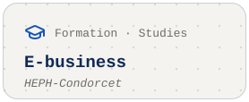
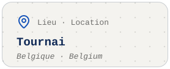
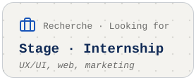
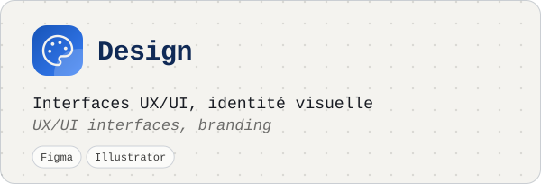
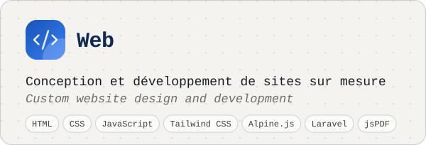
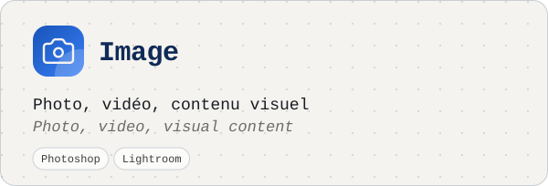
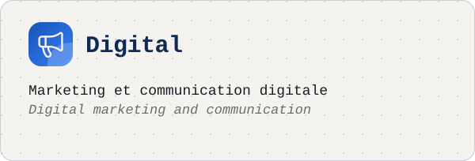
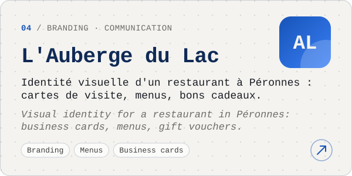
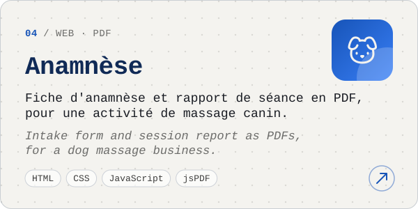

<picture>
  <source media="(prefers-color-scheme: dark)" srcset="https://raw.githubusercontent.com/Luca-dsf/Luca-dsf/main/assets/banner-dark.svg">
  

[CV en français](https://lucadistefano.be/portfolio/assets/documents/cv-luca-di-stefano.pdf) · [CV in English](https://lucadistefano.be/portfolio/assets/documents/English-CV-2026-DiStefanoLuca.pdf)

</picture>

> [!NOTE]
> **Disponible** pour un stage et pour de nouveaux projets. [Me contacter](https://lucadistefano.be/portfolio/#contact)
>
> **Available** for an internship and for new projects. [Get in touch](https://lucadistefano.be/portfolio/#contact)

<h3>
  <picture>
    <source media="(prefers-color-scheme: dark)" srcset="https://raw.githubusercontent.com/Luca-dsf/Luca-dsf/main/assets/header-about-dark.svg">
    
  </picture>
</h3>

| Français | English |
|---|---|
| Étudiant en E-business à la HEPH-Condorcet de Tournai, en Belgique. J'imagine et je conçois des expériences digitales modernes qui combinent design, développement et image : sites web, identités visuelles, contenus photo et vidéo. | E-business student at HEPH-Condorcet in Tournai, Belgium. I design and build modern digital experiences that combine design, development and imagery: websites, visual identities, photo and video content. |

  <picture>
    <source media="(prefers-color-scheme: dark)" srcset="https://raw.githubusercontent.com/Luca-dsf/Luca-dsf/main/assets/fact-formation-dark.svg">
    
  </picture>
  <picture>
    <source media="(prefers-color-scheme: dark)" srcset="https://raw.githubusercontent.com/Luca-dsf/Luca-dsf/main/assets/fact-lieu-dark.svg">
    
  </picture>
  <picture>
    <source media="(prefers-color-scheme: dark)" srcset="https://raw.githubusercontent.com/Luca-dsf/Luca-dsf/main/assets/fact-recherche-dark.svg">
    
  </picture>

<h3>
  <picture>
    <source media="(prefers-color-scheme: dark)" srcset="https://raw.githubusercontent.com/Luca-dsf/Luca-dsf/main/assets/header-skills-dark.svg">
    
  </picture>
</h3>

  <picture>
    <source media="(prefers-color-scheme: dark)" srcset="https://raw.githubusercontent.com/Luca-dsf/Luca-dsf/main/assets/skill-design-dark.svg">
    
  </picture>
  <picture>
    <source media="(prefers-color-scheme: dark)" srcset="https://raw.githubusercontent.com/Luca-dsf/Luca-dsf/main/assets/skill-web-dark.svg">
    
  </picture>
  <picture>
    <source media="(prefers-color-scheme: dark)" srcset="https://raw.githubusercontent.com/Luca-dsf/Luca-dsf/main/assets/skill-image-dark.svg">
    
  </picture>
  <picture>
    <source media="(prefers-color-scheme: dark)" srcset="https://raw.githubusercontent.com/Luca-dsf/Luca-dsf/main/assets/skill-digital-dark.svg">
    
  </picture>

<h3>
  <picture>
    <source media="(prefers-color-scheme: dark)" srcset="https://raw.githubusercontent.com/Luca-dsf/Luca-dsf/main/assets/header-projects-dark.svg">
    
  </picture>
</h3>

  <a href="https://lucadistefano.be/portfolio/#projet-dans-auto"><picture><source media="(prefers-color-scheme: dark)" srcset="https://raw.githubusercontent.com/Luca-dsf/Luca-dsf/main/assets/card-dans-auto-dark.svg"></picture></a>
  <a href="https://lucadistefano.be/portfolio/#projet-burnout-fuel"><picture><source media="(prefers-color-scheme: dark)" srcset="https://raw.githubusercontent.com/Luca-dsf/Luca-dsf/main/assets/card-burnout-fuel-dark.svg"></picture></a>
  <a href="https://lucadistefano.be/portfolio/#projet-auberge-du-lac"><picture><source media="(prefers-color-scheme: dark)" srcset="https://raw.githubusercontent.com/Luca-dsf/Luca-dsf/main/assets/card-auberge-du-lac-dark.svg"></picture></a>
  <a href="https://lucadistefano.be/portfolio/#projet-anamnese"><picture><source media="(prefers-color-scheme: dark)" srcset="https://raw.githubusercontent.com/Luca-dsf/Luca-dsf/main/assets/card-anamnese-dark.svg"></picture></a>

  <a href="https://lucadistefano.be/portfolio/#projets"><picture><source media="(prefers-color-scheme: dark)" srcset="https://raw.githubusercontent.com/Luca-dsf/Luca-dsf/main/assets/btn-projects-dark.svg"></picture></a>

<!--
Statistiques GitHub : à activer quand tu auras quelques dépôts publics avec des commits.
Sans activité publique, les cartes affichent des zéros. Décommente ce bloc pour les afficher.

<picture>
  <source media="(prefers-color-scheme: dark)" srcset="https://github-readme-stats.vercel.app/api?username=Luca-dsf&show_icons=true&hide_border=true&locale=fr&title_color=397ff6&icon_color=397ff6&text_color=e9e7e1&bg_color=0b1424">
  
</picture>
<picture>
  <source media="(prefers-color-scheme: dark)" srcset="https://github-readme-stats.vercel.app/api/top-langs/?username=Luca-dsf&layout=compact&hide_border=true&locale=fr&title_color=397ff6&text_color=e9e7e1&bg_color=0b1424">
  
</picture>

-->

<h3>
  <picture>
    <source media="(prefers-color-scheme: dark)" srcset="https://raw.githubusercontent.com/Luca-dsf/Luca-dsf/main/assets/header-contact-dark.svg">
    
  </picture>
</h3>

  <a href="https://lucadistefano.be/portfolio/#contact"><picture><source media="(prefers-color-scheme: dark)" srcset="https://raw.githubusercontent.com/Luca-dsf/Luca-dsf/main/assets/btn-contact-dark.svg"></picture></a>
  <a href="https://lucadistefano.be/portfolio/"><picture><source media="(prefers-color-scheme: dark)" srcset="https://raw.githubusercontent.com/Luca-dsf/Luca-dsf/main/assets/btn-portfolio-dark.svg"></picture></a>
  <a href="https://www.linkedin.com/in/luca-distefano"><picture><source media="(prefers-color-scheme: dark)" srcset="https://raw.githubusercontent.com/Luca-dsf/Luca-dsf/main/assets/btn-linkedin-dark.svg"></picture></a>

